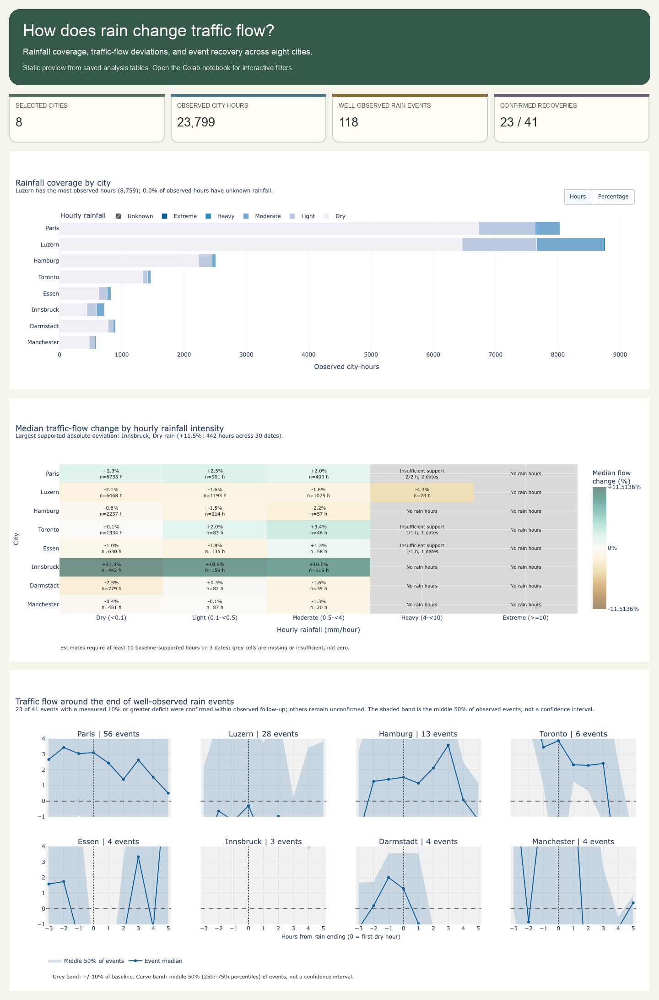

# Rainfall and Traffic Flow Across Eight Cities

This project describes how hourly rainfall relates to traffic flow in eight cities and how flow varies after well-observed rain events.

## Dashboard preview

This snapshot shows three of the dashboard charts from a saved run. Open the linked notebook in Colab and start the Dash app to explore all five charts and use the interactive filters.

## Public dashboard (independent of Colab)

The standalone Dash app uses the precomputed CSVs in `rainfall_analysis_cloud/`; it does not
download the original 1.92 GB file or depend on a running notebook. To publish it on Render:

1. Sign in to Render and choose **New → Blueprint**.
2. Connect this GitHub repository and select the branch to deploy.
3. Render reads `render.yaml`, installs `requirements.txt`, and starts `app.py`.
4. Open the `onrender.com` URL Render provides. The `/healthz` endpoint is used for health checks.

The public app is separate from the Colab workflow. Render's free service may spin down after
inactivity and take time to wake up, but it does not require the Colab runtime to remain active.
The deployment uses the checked-in summary CSVs; regenerate and commit those files when you
want to publish updated analysis results.

## Run the notebook

1. Open [FinalProjectIUTF.ipynb in Google Colab](https://colab.research.google.com/github/divyakapoor23/IUTF_Viz/blob/main/FinalProjectIUTF.ipynb). Sign in and connect a runtime.
2. Run **Install notebook dependencies**, then run the notebook in order through **Run and validate the analysis**. The loader streams the 1.92 GB public CSV and keeps the eight selected cities in memory. Allow time for the download and analysis.
3. Run **My Web App**, then **Open the dashboard**. In Colab, open the new-tab link generated for the active runtime. Keep the notebook open and connected. In local Jupyter, click the localhost link shown by the cell.

The default `DATA_SOURCE = 'google_cloud'` reads the same public CSV as the original notebook. The data load needs internet access and uses no spreadsheet credentials or data upload. [Google Cloud Storage CSV](https://storage.googleapis.com/bucket-quickstart-iutfdataset/all_cities_combined.csv) · [Project1.ipynb](https://github.com/divyakapoor23/IUTF_Viz/blob/main/Project1.ipynb)

For Canvas submission, save the finished notebook to Drive, enable public viewer access, and verify the Drive copy's URL while signed out. The [Milestone 2 rubric](https://iu.instructure.com/courses/2426000/assignments/19059131) specifies Google Sheets for the Colab hosting option. This project uses Google Cloud Storage, so rubric compliance depends on an instructor exception.

## Visualizations

1. **Rainfall coverage:** stacked city-hour counts by rainfall class, including unknown weather; switch between hours and within-city percentages.
2. **Traffic flow by rainfall intensity:** a zero-centered heatmap of median percentage change from matched dry baselines. Estimates require at least 10 supported hours across 3 dates; missing and insufficient cells are labelled.
3. **Traffic patterns by hour of day:** median dry and rainy flow deviations with supported city-hour counts.
4. **Storm intensity vs. traffic disruption:** each qualifying event’s peak hourly rainfall and lowest flow deviation during rain.
5. **Traffic flow after rain ends:** event-aligned city panels with event medians and middle-50% bands. Bands show event variation, not confidence intervals.

City selection applies to all five charts. The hourly comparison uses the day-type filter and keeps both dry and rainy hours visible. The other charts and KPI cards also respond to the day-type and rainfall-intensity filters. Event charts classify events by peak hourly rainfall. Section 7a of the notebook contains additional exploratory plots, including the daily rainfall calendar.

The rainfall coverage chart uses light-to-dark blues from Dry through Extreme. Dry dots and an unknown-weather hatch provide additional cues. The flow heatmap uses a separate zero-centered brown-to-blue scale. Its insight ranks gaps in percentage points between the supported rainy and dry medians for the same city and day-type selection.

## Color-accessibility verification

The visual review applied Color Oracle’s official Java simulation engine to screenshots of the running Dash app. It covers all five charts at 1,280 px and 430 px under protanopia, deuteranopia, and tritanopia, plus a filtered view with an Innsbruck event selected. The evidence compares each original capture with all three simulations. [Color Oracle screenshot review](docs/color-oracle-review.pdf) · [Simulator source](https://github.com/nvkelso/color-oracle-java/blob/523772c178c48a3d9e3dead2146eafe0c087f21e/src/ika/colororacle/Simulator.java)

The review led to dotted dry bars, striped dry sample-count bars, higher-contrast heatmap labels, and clearer titles and legends on narrow screens. The selected recovery curve uses dashes and diamonds alongside the solid median. Dense storm points can still overlap. The notebook’s separate 35 RGB-unit rule checks pairwise separation of the categorical palette as colors change.

## Data and limitations

Hourly precipitation is multiplied by 1,000 to convert metres of accumulation per hour to mm/hour. Rainfall bins and matched dry baselines are calculated from the CSV. Explicitly missing rainfall is shown as unknown. The weather join remains unresolved because the export lacks the original weather timestamps and match status. Some upstream imputed zeros may appear as dry hours.

Each dry baseline uses at least three valid dry observations for the same city, sensor, hour of day, and day type. An observed dry hour is withheld from its own reference. A city-hour estimate requires at least five supported sensors covering at least half the recorded sensors. Missing or unsupported estimates remain blank in the results table and are labelled in the heatmap. A displayed zero represents a measured deviation at the displayed precision.

Events use a fixed sensor panel and hold out the event window when computing the dry reference. Recovery requires an observed deficit of at least 10% followed by two consecutive dry hours within ±10% of baseline. Unconfirmed events retain a blank recovery time. Findings describe associations across unequal observation periods and seasons.

The optional raw-Parquet mode and full-city audit require separate local source folders; they are not used in the default Colab workflow.

## Walkthrough

**Stream recording link: to be added by the author.** The required face-camera walkthrough and Stream sharing verification must be completed after running the notebook with current data.
